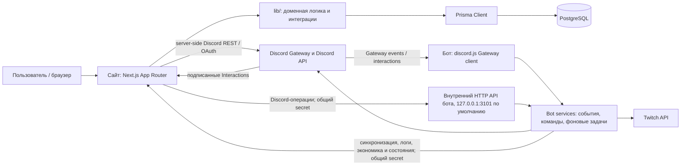
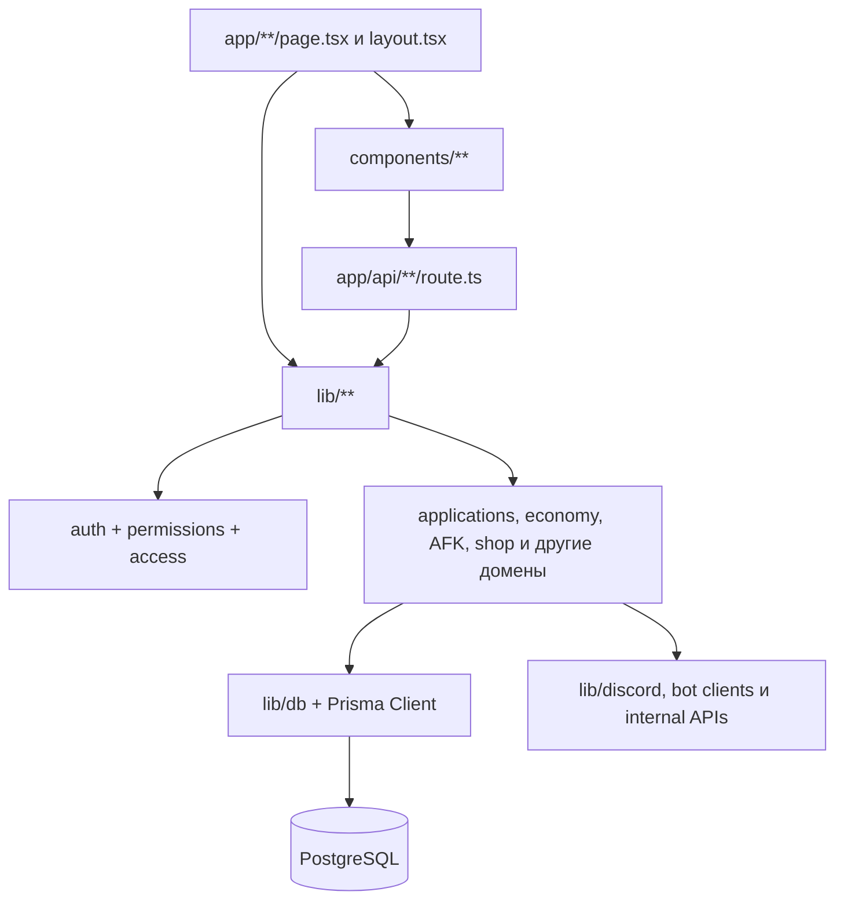
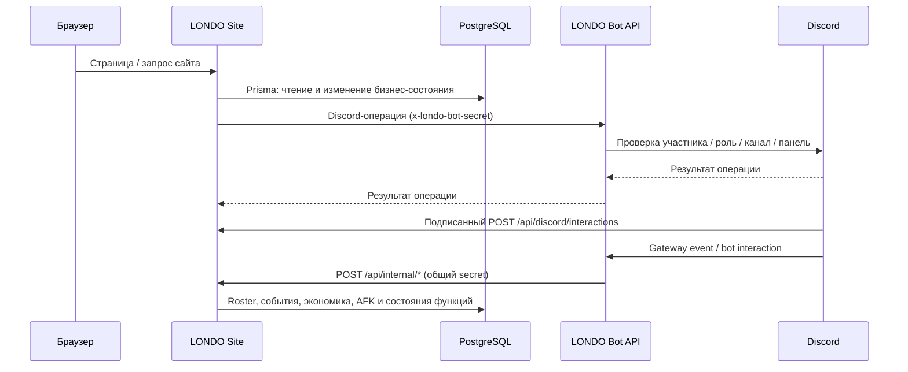

# LONDO — полная карта проектов

Срез исходного кода на 2026-10-12. В карте объединены два самостоятельных приложения: Next.js-сайт и Discord-бот. Это соседние проекты, а не единый npm workspace.

> Graphify как доступный инструмент VS Code и как локальная команда в среде не обнаружен. Карта составлена по исходному коду, конфигурации, схеме Prisma и документации; Mermaid-графы ниже являются исходным текстовым представлением карты.

## 1. Общая архитектура



**Границы ответственности**

- `londo-site-main` — интерфейс, серверные API, авторизация и роли доступа, бизнес-состояние, PostgreSQL и аудит.
- `londo-bot-main` — соединение Discord Gateway, чтение/изменение состояния Discord, Discord-команды/панели и внутренний HTTP API. Бот не подключается к PostgreSQL напрямую.
- Сайт вызывает HTTP API бота для операций, требующих Discord-состояния; бот вызывает внутренние API сайта, чтобы записывать события и синхронизировать данные. Между процессами используется `LONDO_BOT_API_SECRET` в заголовке `x-londo-bot-secret`.
- Пользовательские Discord Interactions формы заявок приходят на сайт отдельно и проверяются подписью Discord (`DISCORD_APPLICATION_PUBLIC_KEY`), а не секретом site↔bot.

## 2. Дерево корня

```text
C:\LONDO\
├── londo-site-main/       Next.js-сайт, Prisma и PostgreSQL
├── londo-bot-main/        Discord-бот и внутренний HTTP API
└── PROJECT_MAP.md         этот документ
```

Оба проекта имеют собственный `package.json`, зависимости, TypeScript и ESLint-конфигурацию. Настройки окружения и запуск независимы. Сайт — Next.js 16 / React 19 / TypeScript / Tailwind 4 / Prisma 6. Бот — Node.js / TypeScript / discord.js 14.

## 3. Сайт: карта модулей

### Точка входа и инфраструктура

- [README](londo-site-main/README.md) — настройка, локальный запуск, OAuth и границы функций.
- [package.json](londo-site-main/package.json) — dev/build/lint/test и зависимости.
- [app/layout.tsx](londo-site-main/app/layout.tsx) — корневой layout, язык, theme providers и глобальные стили.
- [proxy.ts](londo-site-main/proxy.ts) — передаёт текущий путь в заголовке; не выполняет авторизацию.
- [next.config.ts](londo-site-main/next.config.ts) — разрешённые удалённые изображения Discord CDN.
- [lib/db/prisma.ts](londo-site-main/lib/db/prisma.ts) — общий экземпляр Prisma Client.
- [prisma/schema.prisma](londo-site-main/prisma/schema.prisma) — PostgreSQL-схема; `prisma/migrations/` — история изменений.

### Слои сайта



- `app/` — публичные/авторизованные страницы и HTTP Route Handlers.
- `components/` — клиентские интерфейсы и общие компоненты, сгруппированные по доменам.
- `lib/` — авторизация, проверки доступа, валидация, работа с данными, правила доменов и интеграции; именно здесь серверный код обращается к Prisma и Discord.
- `prisma/` — схема PostgreSQL и миграции.
- `docs/` — контракты и эксплуатационные заметки функций.
- `scripts/` — DB/HTTP/integration проверки отдельных сценариев.
- `public/` — статические брендовые и серверные изображения.

### Страницы сайта (App Router)

Группы в скобках — route groups и не входят в публичный URL.

| Область | URL |
|---|---|
| Маркетинг | `/`, `/about` из `app/(marketing)/` |
| Состояние аккаунта | `/access-denied`, `/account-banned`, `/account-suspended`, `/auth/error` |
| Авторизация и рабочее пространство | `/dashboard`, `/family-settings` |
| Доступы и PIN | `/access`, `/access/manage`, `/access/pin/setup`, `/access/pin/verify` |
| Подача и управление заявками | `/apply`, `/applications`, `/applications/[family]`, `/applications/[family]/[id]` |
| Семейные разделы | `/memphis`, `/memphis/roster`, `/memphis/afk`, `/memphis/promotions`; `/phoenix`, `/phoenix/roster`, `/phoenix/afk`, `/phoenix/promotions` |
| Журналы | `/logs`, `/logs/[id]` |
| Профиль | `/profile`, `/profile/[userId]`, `/profile/customize` |
| Экономика | `/economy` |
| Магазин | `/shop`, `/shop/settings`, `/shop/purchases`, `/shop/items/new`, `/shop/items/[id]` |
| Розыгрыши | `/giveaways`, `/giveaways/new`, `/giveaways/[id]` |
| Рулетка | `/roulette`, `/roulette/admin`, `/roulette/admin/history`, `/roulette/admin/prizes/new`, `/roulette/admin/prizes/[id]` |
| Повышения и роли фракций | `/promotions/admin`, `/faction-roles` |
| Настройки | `/notification-settings`, `/settings/interface`, `/settings/rank-colors`, `/settings/discord-checks` |
| Предпросмотры | `/design-preview/[concept]`, `/design-preview/discord-profile` |

### HTTP API сайта

Реализация — `app/api/**/route.ts`; доменная обработка обычно делегируется в `lib/**`. Динамические сегменты в квадратных скобках — параметры URL.

| Группа | URL |
|---|---|
| OAuth / сессия | `/api/auth/discord`, `/api/auth/discord/callback`, `/api/auth/sign-out` |
| Формы / Discord | `/api/apply`, `/api/applications`, `/api/discord/interactions` |
| Доступы / roster / AFK | `/api/access`, `/api/roster/[family]`, `/api/afk/[family]`, `/api/rank-colors` |
| Заявки-повышения / фракционные роли / уведомления | `/api/promotions/[family]`, `/api/faction-roles`, `/api/notification-settings` |
| Профиль и настройки | `/api/profile/customization`, `/api/preferences/ui-theme` |
| Экономика | `/api/economy/users`, `/api/economy/grant`, `/api/economy/debit`, `/api/economy/history` |
| Магазин | `/api/shop`, `/api/shop/settings`, `/api/shop/options`, `/api/shop/refresh`, `/api/shop/items`, `/api/shop/items/[id]`, `/api/shop/purchases/[id]/complete`, `/api/shop/purchases/[id]/refund` |
| Розыгрыши | `/api/giveaways`, `/api/giveaways/discord-options`, `/api/giveaways/[id]`, `/api/giveaways/[id]/start`, `/api/giveaways/[id]/finish`, `/api/giveaways/[id]/cancel`, `/api/giveaways/[id]/reroll` |
| Рулетка | `/api/roulette`, `/api/roulette/spin`, `/api/roulette/admin/settings`, `/api/roulette/admin/prizes`, `/api/roulette/admin/prizes/[id]`, `/api/roulette/admin/history/[id]` |
| Внутренние вызовы бота → сайт | `/api/internal/access-sync`, `/api/internal/afk`, `/api/internal/discord-checks/prune`, `/api/internal/faction-roles`, `/api/internal/giveaways/active`, `/api/internal/giveaways/[id]/finish`, `/api/internal/giveaways/[id]/join`, `/api/internal/giveaways/[id]/leave`, `/api/internal/giveaways/[id]/message`, `/api/internal/leaderboard`, `/api/internal/logs`, `/api/internal/notifications`, `/api/internal/promotions`, `/api/internal/roster`, `/api/internal/roster/member-sync`, `/api/internal/shop`, `/api/internal/twitch/profiles`, `/api/internal/twitch/profiles/[discordUserId]`, `/api/internal/twitch/state`, `/api/internal/voice` |

Внутренние site endpoints проверяют общий secret. Авторизация пользователя, права доступа и origin-проверки выполняются серверными route handlers и соответствующими доменными модулями, а не видимостью кнопок в UI.

### Доменная карта `lib/`

| Каталог | Ответственность |
|---|---|
| `auth/`, `permissions/`, `access/`, `families/` | Discord OAuth, сессии, RBAC, доступ к функциям и семейные права |
| `db/`, `env/` | Prisma Client и публичная конфигурация приложения |
| `discord/`, `discord-checks/` | Discord identity/API, interactions, OAuth-согласия и проверки участника/ролей |
| `applications/` | Приём, отображение, редактирование и рассмотрение заявок |
| `roster/`, `rank-appearance/` | Семейный roster, отображение рангов и цветов |
| `logs/` | Контракт, валидация и чтение событий аудита |
| `economy/` | Балансы, история, ручные начисления/списания и API |
| `afk/` | AFK-заявки и сессии, правила срока, доступы и вызовы бота |
| `shop/` | Каталог магазина, настройки, покупки и bot API |
| `giveaways/` | Жизненный цикл розыгрыша и интеграция с bot |
| `roulette/` | Настройки, случайный выбор, вращения, история и доставка Discord-наград |
| `promotions/` | Конфигурация рангов, критериев/вопросов и заявок на повышение |
| `faction-roles/` | Панели ролей фракций и безопасные операции над ролями |
| `notifications/` | Настройки уведомлений семей и доставка через bot |
| `profile-customization/`, `ui-theme/` | Внешний вид профилей и пользовательская тема |
| `twitch/` | Внутренний API состояния Twitch-профилей/стримов |

### Схема PostgreSQL (Prisma)

Основные модели из `prisma/schema.prisma`, сгруппированные по домену:

- **Identity/auth/access:** `User`, `Session`, `DiscordIdentity`, `UserAccessSnapshot`, `StaffAccessGrant`, `StaffAccessCredential`, `StaffAccessRequest`, `DiscordOAuthConsent`, `DiscordApplicationCheck`, `DiscordGuildWatchlist`.
- **Аудит и события:** `AuditLog`, `LogEvent`.
- **Семьи и roster:** `FamilyMembership`, `FamilyApplication`.
- **Голос и экономика:** `VoiceProfile`, `VoiceActiveSession`, `EconomyTransaction`.
- **Магазин:** `FamilyShopSettings`, `ShopItem`, `ShopPurchase`.
- **Розыгрыши:** `Giveaway`, `GiveawayParticipant`, `GiveawayWinner`, `GiveawayDrawEvent`.
- **AFK:** `AfkApplication`, `AfkSession`.
- **Рулетка:** `RouletteSettings`, `RoulettePrize`, `RouletteSpin`.
- **Повышения:** `PromotionSettings`, `PromotionRank`, `PromotionCriterion`, `PromotionQuestion`, `PromotionApplication`.
- **Роли фракций и уведомления:** `FactionRolePanelSettings`, `FactionRoleButton`, `FactionRoleOperation`, `FamilyNotificationSettings`, `ApplicationNotificationReceipt`.
- **Внешний вид:** `ProfileCustomization`, `RankAppearance`.
- **Twitch:** `TwitchProfile`, `TwitchStreamState`.

Доменные enum включают роли/статусы пользователей и заявок, семейства MEMPHIS/PHOENIX, статусы розыгрышей/магазина/AFK/рулетки/повышений, типы и источники экономических транзакций и типы событий аудита. Уникальные ограничения, транзакции и миграции обеспечивают целостность, идемпотентность и параллельные операции.

## 4. Бот: карта модулей

### Точка входа и инфраструктура

- [README](londo-bot-main/README.md) — правила roster и базовая настройка.
- [package.json](londo-bot-main/package.json) — `dev`, `start`, `lint`, `typecheck`, `test`.
- [src/index.ts](londo-bot-main/src/index.ts) — запуск клиента, подписки на Discord events/interactions, загрузка модулей, фоновые циклы и graceful shutdown.
- [src/discord.ts](londo-bot-main/src/discord.ts) — discord.js Client; intents `Guilds` и `GuildMembers`.
- `src/config/discord.ts` — env-конфигурация Discord, application API, voice, guide, Twitch и необязательных функций.
- `src/config/siteLogs.ts` — конфигурация связи с сайтом.
- `src/config/familyRanks.ts` — каноническое сопоставление Discord role ID с семейными рангами.
- `src/config/nicknameGuard.ts` — исключения для проверки смены nickname.
- `src/types/family.ts` — типы семейств, Discord/application и интеграционных настроек.
- `src/utils/logger.ts` — единая безопасная регистрация событий и ошибок.

### Runtime-поток

1. `src/index.ts` загружает обязательные Discord env, создаёт Discord client и подключается к Guild.
2. На `ClientReady` получает роли и список участников, строит roster MEMPHIS/PHOENIX, настраивает панели и команды.
3. Если настроена связь с сайтом, запускает синхронизацию ролей/roster, голосовую экономику, журналы и активные фоновые сервисы.
4. Если заданы application channel/category, общий API secret и допустимый порт, `applicationServer.ts` слушает только `127.0.0.1` и обслуживает внутренние вызовы сайта.
5. Discord `InteractionCreate`, `GuildMemberUpdate`, `GuildMemberAdd/Remove` и `VoiceStateUpdate` делегируются профильным сервисам.

### Доменные сервисы `src/services/`

- **Guild и roster:** `guild.ts`, `members.ts`, `ranks.ts`, `main-ranks.ts`, `rosterSync.ts`, `memberRosterSync.ts`, `memberSyncScheduler.ts`.
- **Заявки:** `applicationPanel.ts`, `applicationIntake.ts`, `applicationMembership.ts`, `applicationServer.ts` — панель/Discord modal, приём данных, member checks, создание каналов звонка, назначение роли и очистка каналов.
- **Доступы / журналы:** `accessSync.ts`, `siteLogs.ts`, `discordCheckRetention.ts`.
- **Никнеймы:** `nickname.ts`, `nicknameGuard.ts`, `nicknameAudit.ts`.
- **Голос / экономика / leaderboard:** `voiceTracker.ts`, `voiceClient.ts`, `leaderboard.ts`.
- **AFK / магазин / giveaways / promotions / faction roles:** `afk.ts`, `shop.ts`, `giveaways.ts`, `promotions.ts`, `factionRoles.ts`.
- **Уведомления:** `notifications.ts`.
- **Информационные панели:** `guide.ts`, `welcome.ts`, `leaderboard.ts`.
- **Twitch:** `twitchStreams.ts` — список профилей, опрос статуса стримов и объявления.
- Почти все доменные сервисы имеют соседние `*.test.ts`; тесты проверяют правила и HTTP/Discord-адаптеры.

### Внутренний HTTP API бота (site → bot)

Сервер создаётся в `src/services/applicationServer.ts`, слушает loopback, валидирует JSON/ID и общий secret.

| Группа | Маршруты и операции |
|---|---|
| Заявки | `/internal/applications/:id/call`, `/accept`, `/reject` |
| Проверка участника | `/internal/discord/applications/member`, `/member-roles`; `/internal/discord/access/member` |
| Доступные каналы/роли | `GET /internal/discord/giveaway-options`; `/internal/discord/shop/options` |
| Роли фракций | `/internal/discord/faction-roles/options`, `/publish`, `/refresh` |
| Повышения | `/internal/discord/promotions/options`, `/refresh`, `/check`, `/apply` |
| AFK | `/internal/discord/afk/check`, `/sync` |
| Магазин | `/internal/discord/shop/refresh`, `/role-check` |
| Награды рулетки | `/internal/discord/roulette/deliver` |
| Панели розыгрышей | `/internal/giveaways/:id/publish`, `/refresh`, `/delete` |
| Уведомления | `/internal/discord/notifications/options` |

### Discord Gateway / interactions

Сервисы обрабатывают обновления участников и ролей, nickname guard/audit, вход/выход, состояние voice, кнопки/модальные формы и команды. Используемые setup-команды включают `/setup-applications`, `/setup-leaderboard`, `/test-welcome`, `/setup-guide`, `/setup-promotions`, `/setup-afk`; Twitch-команды регистрируются из `twitchStreams.ts`.

## 5. Двусторонние интеграции



**Основные bot → site каналы:**

- Roster и членство: `/api/internal/roster`, `/api/internal/roster/member-sync`, `/api/internal/access-sync`.
- События и логи: `/api/internal/logs`, `/api/internal/leaderboard`.
- Голос: `/api/internal/voice`.
- AFK, promotions, faction roles, notifications, shop, giveaways: одноимённые `/api/internal/*` endpoints.
- Twitch: `/api/internal/twitch/profiles`, `/api/internal/twitch/profiles/[discordUserId]`, `/api/internal/twitch/state`.
- Discord checks: `/api/internal/discord-checks/prune`.

**Основные site → bot каналы:**

- HTTP клиенты доменов сайта вызывают `/internal/discord/*` для проверки пользователя/ролей, опций ролей/каналов, публикации/обновления панелей и изменения Discord-ролей.
- Заявки и розыгрыши также используют `/internal/applications/*` и `/internal/giveaways/*`.
- Все чувствительные вызовы остаются server-to-server; секреты не должны передаваться клиентскому браузеру.

## 6. Замеченный стык, требующий внимания

В текущем исходном коде bot `src/services/applicationIntake.ts` отправляет POST на сайт `/api/applications`, но `londo-site-main/app/api/applications/route.ts` отвечает `410 Gone` с сообщением о переносе подачи заявок. Это расходится с описанием активного bot intake в README/architecture docs. Сайт также имеет `/api/apply` и отдельный `/api/discord/interactions` для подписанной Discord-формы. Карта фиксирует фактические файлы и не предполагает, что старый вызов bot уже работает.

## 7. Проверки и проектные артефакты

- Site: `npm test`, `npm run lint`, `npx tsc --noEmit`, `npm run build`.
- Bot: `npm test`, `npm run lint`, `npm run typecheck`.
- Site `scripts/` содержит интеграционные проверки economy, faction roles, notifications, profile customization, promotions, roulette, shop, плюс DB/HTTP checks AFK/shop.
- В `londo-site-main/docs/` находятся architecture, AFK, faction roles, shop, log-event contract, manual economy, promotions и roulette.
- Prisma schema и миграции принадлежат сайту; бот хранит runtime state в памяти и синхронизирует долговременные состояния через защищённые API сайта.
